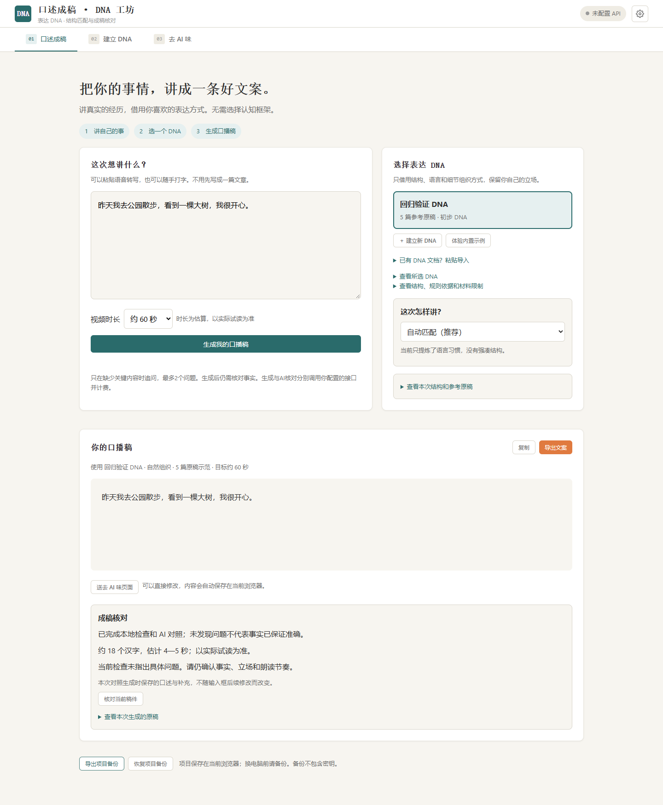

# 口播 DNA 工坊

从参考口播中整理表达方式，把自己的真实口述写成可朗读的文案。

这是一个在自己电脑上运行的工具：**原生 HTML / CSS / JavaScript 前端 + Python 本地服务**。浏览器负责素材、DNA 和文稿操作；本地服务负责视频解析、下载、音频提取及语音转写。无需前端构建工具，不需要安装本地 AI 模型。



> 截图使用模拟素材和模拟模型响应，仅展示界面与操作流程。

## 能做什么

- **导入参考原稿**：直接粘贴文字，多篇用独占一行的 `---` 分隔；也可逐篇添加。
- **分享链接转文字**：粘贴抖音／小红书视频链接，或直接粘贴平台复制的整段分享文案；支持两个平台混填。
- **逐条处理**：自动跳过重复链接，每条显示排队、解析、下载、音频提取、转写与结果；失败项可单独重试。
- **确认原稿**：查看和修改标题、转写原文，再加入原稿列表；保留平台、原始链接和未经修改的转写结果。
- **建立表达 DNA**：从至少 5 篇不重复原稿中整理语言习惯、结构与原文依据，分析后手动保存到 DNA 库。20 篇是建议样本量。
- **口述成稿**：选一个 DNA，讲自己的经历与意图，匹配表达结构后生成口播稿，并提供成稿核对提示。
- **去 AI 味**：保留原有的规则清理页面。
- **项目备份**：导出／恢复 DNA 库、原稿、分析缓存与文稿；备份不带 API 密钥。

**转写原文只是参考素材，不是已经生成的 DNA。** 同一批原稿应来自同一位参考作者；不强制填写作者信息。参考作者的立场、经历和事实不应被当作用户自己的内容。

## 当前适用范围

当前版本优先面向 **Windows 本地使用**，已在 Python 3.11、FFmpeg 8 和 Edge 上验证。

- 运行需要 **Python 3.10+**、**FFmpeg 与 FFprobe**，并能从命令行调用。
- 视频解析、转写和写作模型均使用用户自己的第三方 API 配置，需要联网，可能产生服务商费用。
- 不提供托管服务或账号系统；不支持把服务直接暴露到公网。
- 单独下载 `web/index.html` 不能完整使用本项目；需要下载整个仓库并启动服务。GitHub Pages 也不能运行 Python / FFmpeg 后端。

## 快速开始

### 1. 准备环境

安装 [Python](https://www.python.org/downloads/) 和 [FFmpeg](https://ffmpeg.org/download.html)，确保安装目录加入 `PATH`。FFmpeg 发行包需要同时包含 `ffmpeg` 和 `ffprobe`。

在终端检查：

```powershell
python --version
ffmpeg -version
ffprobe -version
```

### 2. 下载项目并启动

可以在 GitHub 点击 **Code → Download ZIP** 后解压，也可以使用 Git：

```powershell
git clone https://github.com/william854014048-ops/spoken-dna-workshop.git
cd spoken-dna-workshop
python -B server.py
```

然后访问 **<http://127.0.0.1:8765>**。

Windows 也可双击项目根目录的 **`启动.cmd`**，它会在后台启动服务。停止时双击 **`停止.cmd`**；如果直接在终端启动，用 `Ctrl+C` 停止。

运行不需要 `pip install` 或 `npm install`：Python 服务只使用标准库，前端没有运行依赖。Node.js 仅用于可选的浏览器回归检查。

### 3. 配置自己的 API

点击页面右上角齿轮：

| 配置 | 用途 | 默认接口／模型 |
| --- | --- | --- |
| 写作模型 API Key、Base URL、模型 | DNA 分析、口述成稿、成稿核对和去 AI 味 | OpenAI 兼容的 `/chat/completions`；默认 DeepSeek |
| 语音识别 API Key | 把音轨转成文字 | 硅基流动 `https://api.siliconflow.cn/v1/audio/transcriptions`；`FunAudioLLM/SenseVoiceSmall` |
| 起零数据 Token | 从平台分享链接解析视频 | `https://api.istero.com/resource/v2/video/analysis` |

这三项凭据相互独立。只使用文字原稿时，可以不配置视频解析与语音识别。

- 写作模型密钥仅在当前网页会话使用，刷新后需重新填写；调用仍由浏览器直连服务商，所填接口需要允许网页跨域访问。
- 新填写的转写密钥默认只保留至本地服务停止；勾选“记住”后，由 Windows 当前用户 DPAPI 加密保存，不能直接搬到其他电脑或 Windows 用户下解密。
- 转写密钥只发给本机服务，不会以明文返回页面、写入源码或项目备份。
- 配置中只显示是否已填写；提交视频才会验证真实接口权限和可用性。

也可使用环境变量 `ISTERO_API_TOKEN`、`SILICONFLOW_API_KEY`，或将 `.env.example` 复制为 `.env.local` 后填写。**环境文件是明文，已被 Git 忽略；推荐在页面填写并按需使用 Windows 加密保存。** 需要复用另一个已有环境文件时，可通过 `SPOKEN_DNA_ENV_FILE` 指定其路径。

起零接入使用 Bearer Token，不实现其可选的动态签名机制。开启动态签名要求的应用需要另行适配。参考：[起零官方文档](https://api.istero.com/service/doc/video-parse)。

### 4. 使用流程

```text
同一位参考作者的文字／视频链接
    → 查看并修改原稿
    → 加入原稿列表
    → 建立表达 DNA
    → 保存到 DNA 库
    → 输入自己的真实口述
    → 生成、核对、试读和修改
```

链接导入位于 **“建立 DNA → 分享链接”**。每批最多 50 条，后台最多同时处理 2 条。转写成功后，展开“查看／修改转写原文”，确认后点击“加入原稿列表”。


> 此图为模拟批次，展示成功项和单项重试的状态。

## 保存、迁移与分享

| 内容 | 保存位置 |
| --- | --- |
| DNA 库、已加入的原稿、口述和文稿 | 当前浏览器的 localStorage |
| 转写队列、待确认结果和初始转写 | `data/jobs.json` |
| 本地设置 | `data/settings.json` |
| 可选的 Windows 加密凭据 | `data/credentials.dpapi` |
| 临时媒体 | `runtime/temp/` |
| 日志与启动状态 | `runtime/logs/`、`runtime/server.json` |

`data/`、`runtime/`、`.env.local`、开发依赖均不进入 Git。日志不记录请求体、密钥或上游原始错误。临时媒体在成功或失败后删除；程序被强制结束的残留会在下次启动清理。

请在“口述成稿”页面底部导出项目备份。转写结果需先加入原稿列表，才会随项目备份带走。浏览器数据不会随源码自动迁移，也不会自动同步到其他浏览器。

从原单文件 HTML 迁移：先在原页面导出项目备份，再在本地地址恢复。始终使用 `127.0.0.1:8765`，避免与 `localhost` 混用而看到不同的浏览器数据。恢复前会提示替换当前项目。

分享给别人时，让对方下载整个仓库、准备环境并填写自己的密钥；不要发送自己的 `data/`、`runtime/` 或环境文件。

## 已知限制与验证状态

- 当前只支持**视频转文字**；小红书图文／图集、无效链接、无音轨和空转写会明确失败。
- 单条最多 400 MB、60 分钟；音频按最多 3 分钟分段转写，单段接口等待最多 10 分钟，单条任务设有 45 分钟处理期限。超限会停止，不把截断结果当作完整原稿。
- 平台解析成功率取决于分享链接、内容可访问性和第三方服务；同一链接可单独重试。
- Windows 加密保存与启动／停止脚本已验证；其他系统尚未完整验收，可用 Python 直接启动，不能使用 Windows 加密保存。
- **已真实验证**：一条公开抖音视频完成解析、下载、音轨提取和硅基转写。
- **模拟验证通过**：混合批次、去重、状态、重试、编辑入库、原 DNA 分析和成稿流程、去 AI 味、备份恢复。写作模型输出使用模拟响应。
- **未真实验证**：小红书视频端到端调用、长真人视频、真实写作模型的产出质量。未提供产品效果或事实准确性保证。

详细记录见 [验证说明](docs/VERIFICATION.md)。

## 项目结构与开发

```text
server.py                    本机 HTTP 服务、凭据、导入队列与媒体处理
web/index.html               页面结构
web/workshop.css             原页面基础样式
web/workshop-core.js          原配置、原稿、分析与清理逻辑
web/spoken-workshop.js        DNA 库、口述成稿与备份
web/expression-profile.js     结构化表达规则、材料匹配与成稿核对
web/local.js / local.css      本地配置与分享链接导入界面
tests/test_server.py          后端与媒体处理检查
tests/browser.cjs             模拟上游响应的页面回归检查
```

没有引入 React / Vue 或前端构建流程。前后端已按职责分开；保留原页面业务逻辑，仅将内嵌样式、脚本拆为独立文件。更多说明见 [项目结构与接口](docs/ARCHITECTURE.md)。

后端检查：

```powershell
python -B -m unittest discover -s tests -v
```

可选的页面检查需要 Node.js 18+ 和已安装的 Microsoft Edge：

```powershell
npm ci
# 先启动本地服务，再执行：
npm run test:browser
```

只安装较小的 `playwright-core`，不自动下载浏览器。可通过 `PLAYWRIGHT_CHANNEL=chrome` 选择已安装的 Chrome，或用 `PLAYWRIGHT_CHROMIUM_EXECUTABLE` 指定可执行文件；这些替代浏览器尚未在本项目验收。测试结果、浏览器配置与 npm 缓存写入 `runtime/`，截图写入 `docs/`。API 响应均模拟，不会消耗真实模型额度。
