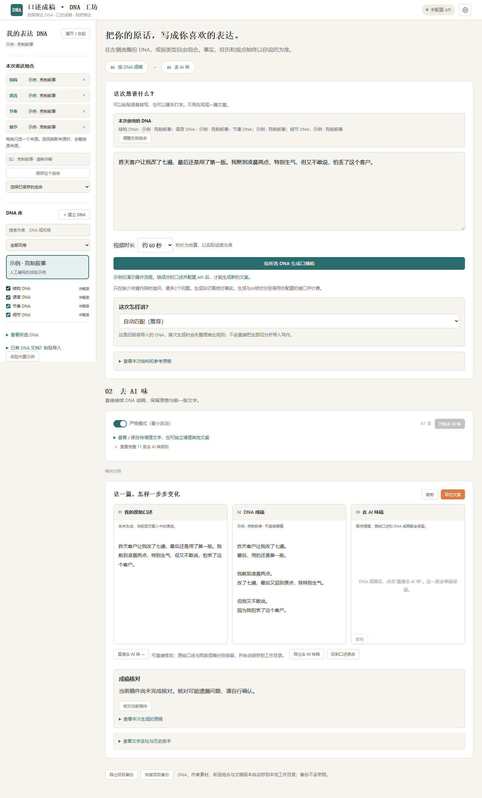
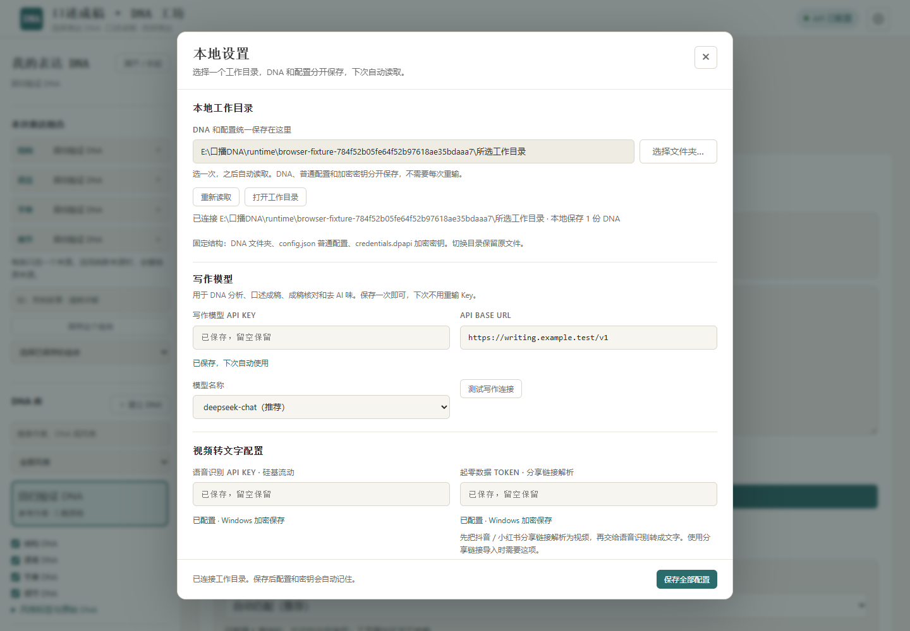
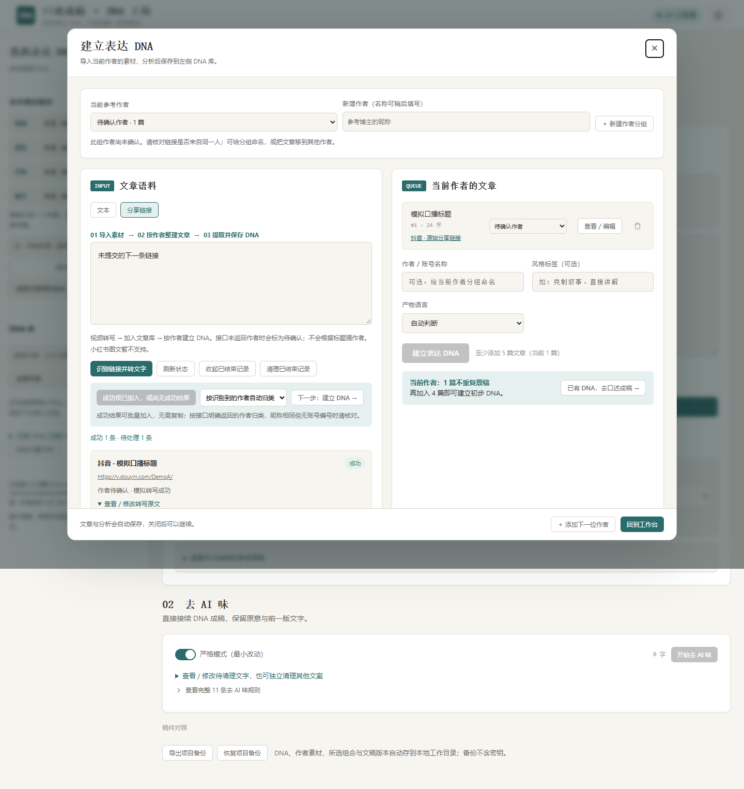

# 口播 DNA 工坊

从参考口播中整理表达方式，把自己的真实口述写成可朗读的文案。

这是一个在自己电脑上运行的工具：**原生 HTML / CSS / JavaScript 前端 + Python 本地服务**。浏览器负责素材、DNA 和文稿操作；本地服务负责视频解析、下载、音频提取、语音转写与写作接口调用。无需前端构建工具，不需要安装本地 AI 模型。



> 截图使用模拟素材和模拟模型响应，仅展示界面与操作流程。

## 能做什么

- **导入参考原稿**：直接粘贴文字，多篇用独占一行的 `---` 分隔；也可逐篇添加。
- **分享链接转文字**：粘贴抖音／小红书视频链接，或直接粘贴平台复制的整段分享文案；支持两个平台混填。
- **逐条处理**：自动跳过重复链接，每条显示排队、解析、下载、音频提取、转写与结果；失败项可单独重试。
- **确认原稿**：查看和修改标题、转写原文，再加入原稿列表；保留平台、原始链接和未经修改的转写结果。
- **建立表达 DNA**：文本和链接转写进入同一套文章库；按作者分别分析至少 5 篇不重复原稿，保存带原文依据的表达规则。20 篇是建议样本量。
- **风格库与自由组合**：左侧选择一位作者的完整 DNA，也可用 A 的结构、语言搭配 B 的节奏、细节；同类型只保留一个来源。可按风格标签筛选、保存常用组合。
- **口述成稿**：讲自己的经历与意图，实际按选定的各类来源匹配结构与表达规则，再生成和核对口播稿。
- **去 AI 味**：生成后直接点击按钮，无需复制；原始口述、DNA 成稿和去 AI 味稿分别显示，保留历史版本与文字变化对照，也支持独立清理其他文案。
- **项目备份**：导出／恢复 DNA 库、原稿、分析缓存与文稿；备份不带 API 密钥。
- **统一工作目录**：通过系统文件夹选择器选择保存位置；DNA、普通配置和加密密钥分开存档，重新启动或清空浏览器缓存后自动读取。

**转写原文只是参考素材，不是已经生成的 DNA。** 同一批原稿应来自同一位参考作者；不强制填写作者信息。参考作者的立场、经历和事实不应被当作用户自己的内容。

## 当前适用范围

当前版本优先面向 **Windows 本地使用**，已在 Python 3.11、FFmpeg 8 和 Edge 上验证。

- 运行需要 **Python 3.10+**、**FFmpeg 与 FFprobe**，并能从命令行调用。
- 系统文件夹选择器使用 Python 的 `tkinter` 组件，需要本机桌面会话；不依赖浏览器上传整个目录。
- 视频解析、转写和写作模型均使用用户自己的第三方 API 配置，需要联网，可能产生服务商费用。
- 不提供托管服务或账号系统；不支持把服务直接暴露到公网。
- 单独下载 `web/index.html` 不能完整使用本项目；需要下载整个仓库并启动服务。GitHub Pages 也不能运行 Python / FFmpeg 后端。

## 快速开始

### 1. 准备环境

安装 [Python](https://www.python.org/downloads/) 和 [FFmpeg](https://ffmpeg.org/download.html)，确保安装目录加入 `PATH`。FFmpeg 发行包需要同时包含 `ffmpeg` 和 `ffprobe`。

在终端检查：

```powershell
python --version
ffmpeg -version
ffprobe -version
```

### 2. 下载项目并启动

可以在 GitHub 点击 **Code → Download ZIP** 后解压，也可以使用 Git：

```powershell
git clone https://github.com/william854014048-ops/spoken-dna-workshop.git
cd spoken-dna-workshop
python -B server.py
```

然后访问 **<http://127.0.0.1:8765>**。

Windows 也可双击项目根目录的 **`启动.cmd`**，它会在后台启动服务。停止时双击 **`停止.cmd`**；如果直接在终端启动，用 `Ctrl+C` 停止。

运行不需要 `pip install` 或 `npm install`：Python 服务只使用标准库，前端没有运行依赖。Node.js 仅用于可选的浏览器回归检查。

### 3. 配置自己的 API

点击页面右上角齿轮打开**设置弹框**，点击“选择文件夹”，在系统窗口中选择本地工作目录，不需要手输路径。未选择时页面会提醒；选择已有的本项目工作目录可恢复其 DNA 和配置。

随后填写需要的 API，点击一次“保存全部配置”。写作模型、接口地址和三项密钥都记在这个目录中，重启无需重复填写：

| 配置 | 用途 | 默认接口／模型 |
| --- | --- | --- |
| 写作模型 API Key、Base URL、模型 | DNA 分析、口述成稿、成稿核对和去 AI 味 | OpenAI 兼容的 `/chat/completions`；默认 DeepSeek |
| 语音识别 API Key | 把音轨转成文字 | 硅基流动 `https://api.siliconflow.cn/v1/audio/transcriptions`；固定使用 `FunAudioLLM/SenseVoiceSmall`，无需配置模型 |
| 起零数据 Token | 从平台分享链接解析视频 | `https://api.istero.com/resource/v2/video/analysis` |

这三项凭据相互独立。起零数据根据抖音／小红书分享链接找到可下载的视频，硅基流动再把音轨转成文字；使用分享链接转文字目前需要这两项。只导入现成文字时，可以不配置这两项。

- 三项密钥均由 Windows 当前用户 DPAPI 加密保存在工作目录的 `credentials.dpapi`，不能直接搬到其他 Windows 用户／电脑下解密。
- 写作请求也通过本地服务，由服务读取已保存的 Key 调用接口，刷新页面无需重新填写，也不要求服务商支持网页跨域。
- 已保存密钥不会以明文返回页面、写入源码或项目备份；密码框留空表示保留已有密钥。
- 配置中只显示是否已填写；提交视频才会验证真实接口权限和可用性。

首次启动也可从环境变量 `ISTERO_API_TOKEN`、`SILICONFLOW_API_KEY` 或已配置的本机环境文件读取已有转写凭据。选择工作目录时会自动加密沿用，无需重新抄写。环境文件是明文且已被 Git 忽略；日常使用推荐通过设置弹框统一保存。



起零接入使用 Bearer Token，不实现其可选的动态签名机制。开启动态签名要求的应用需要另行适配。参考：[起零官方文档](https://api.istero.com/service/doc/video-parse)。

### 4. 使用流程

```text
准备：左侧“建立 DNA”弹窗 → 导入素材 → 按作者分析并保存
工作台：选择 DNA → 口述 → 01 按 DNA 成稿 → 02 去 AI 味 → 三版对照与导出
```

点击左侧 **“建立 DNA”** 打开弹窗，再切换“分享链接”。主工作台没有独立的建立 DNA 或去 AI 味页面。每批最多 50 条，后台最多同时处理 2 条，解析和语音接口各自使用一个共享通道。语音请求默认至少间隔 6 秒，可在配置面板调整；这只是本地保护设置，不代表账号额度。

遇到 HTTP 429 或起零业务码 429，整条接口通道自动冷却后重试，遵守 `Retry-After`，没有该头时采用 15 / 30 / 60 / 120 秒退避，最多自动重试 4 次。明确的日额度／余额耗尽和无效密钥不会被持续重试。账号实际限额仍以[硅基流动账号和模型规则](https://docs.siliconflow.cn/docs/userguide/faqs/rate-limit-and-upgradation)为准。

转写成功后可查看修改原文，单条加入或点击“将成功项加入文章库”批量加入。自动使用解析接口明确返回的作者信息分组；无作者信息的素材单独标为“待确认”，不会按标题猜测作者。可选择统一归入指定作者，或在文章行中移动归属。昵称没有唯一账号编号时仍需核对是否同一人。每位作者单独分析；切换作者会保留各自文章、输入和分析。保存 DNA 后已用转写自动收进“历史转写记录”，可展开回看，失败项仍可重试。再次点击左侧建立按钮或弹窗底部“添加下一位作者”会准备空白分组，旧素材不删除。

DNA 分类先提供结构、语言、节奏、细节四类。有依据才出现该类型，不为凑分类生成规则；旧 DNA 首次使用时整理后再读取。点击整份 DNA 会选中其可用类型，勾选另一作者的同类会替换来源；未选类型按用户内容自然组织。选择和常用组合自动保存。



> 此图为模拟批次，展示成功项和单项重试的状态。

## 保存、迁移与分享

| 内容 | 保存位置 |
| --- | --- |
| 已保存的 DNA、该博主参考原稿、结构化分析 | 工作目录的 `DNA/`，每位博主一个文件夹 |
| 作者素材、DNA 组合、口述、文稿三版与历史 | 工作目录 `workbench.json`，格式 `spoken-dna-workbench/v1`；浏览器另有缓存 |
| 转写队列、待确认结果和初始转写 | `data/jobs.json` |
| 写作接口、模型和普通设置 | 工作目录的 `config.json`，格式 `spoken-dna-config/v1` |
| 三项 Windows 加密密钥 | 工作目录的 `credentials.dpapi` |
| 工作目录位置 | 项目内 `data/settings.json` 只保存路径指针 |
| 临时媒体 | `runtime/temp/` |
| 日志与启动状态 | `runtime/logs/`、`runtime/server.json` |

每份 DNA 目录包含 `dna.json`（程序读取真源，格式 `spoken-dna/v1`）、`Writing-DNA.md`（可直接查看）和 `原稿.json`。程序读取 `dna.json` 中的 `dna` 对象，含名称、DNA 正文、原稿、分析结果及表达规则；可以在本地直接看到自己提取过的所有博主。

首次连接会把当前浏览器里尚未存档的 DNA 和此前直接保存在目录中的 DNA 合并进去，不以旧缓存覆盖目录里已有的同编号版本。之后启动自动读取配置、密钥和 DNA；切换目录不移动或删除原文件。读取失败会保留缓存，损坏文件也不会被静默覆盖。

```text
你选择的工作目录/
  config.json
  credentials.dpapi
  workbench.json
  DNA/
    参考作者--编号/
      dna.json
      Writing-DNA.md
      原稿.json
```

`data/`、`runtime/`、`.env.local`、开发依赖和 DNA／密钥产物不进入 Git。不要把自己的工作目录作为源码上传或分享。日志不记录请求体、密钥或上游原始错误。临时媒体在成功或失败后删除；程序被强制结束的残留会在下次启动清理。

在页面底部可导出项目备份，包含作者素材、DNA 库、组合及文稿版本，不带密钥。转写结果需先加入文章库，才会随备份带走。已选择工作目录后，素材与文稿也会自动写入本地；没有目录时保留浏览器缓存并提示配置。工作区保存有版本校验，其他页面写入后会提示冲突，不静默覆盖。

从原单文件 HTML 迁移：先在原页面导出项目备份，再在本地地址恢复。始终使用 `127.0.0.1:8765`，避免与 `localhost` 混用而看到不同的浏览器数据。恢复前会提示替换当前项目。

分享给别人时，让对方下载整个仓库、准备环境并填写自己的密钥；不要发送自己的 `data/`、`runtime/` 或环境文件。

## 已知限制与验证状态

- 当前只支持**视频转文字**；小红书图文／图集、无效链接、无音轨和空转写会明确失败。
- 单条最多 400 MB、60 分钟；音频按最多 3 分钟分段转写，单段接口等待最多 10 分钟，单条任务设有 45 分钟处理期限。超限会停止，不把截断结果当作完整原稿。
- 平台解析成功率取决于分享链接、内容可访问性和第三方服务；同一链接可单独重试。
- Windows 加密保存与启动／停止脚本已验证；其他系统尚未完整验收，可用 Python 直接启动，不能使用 Windows 加密保存。
- **已真实验证**：一条公开抖音视频完成解析、下载、音轨提取和硅基转写。
- 已修复已知视频 CDN 被本机 Fake-IP DNS（`198.18.x.x`）映射时遭误拦的问题；兼容只针对已知 CDN，仍拒绝真实本机／私网地址和不安全重定向。
- **模拟验证通过**：混合批次、去重、状态、重试、编辑入库、原 DNA 分析和成稿流程、去 AI 味、备份恢复。写作模型输出使用模拟响应。
- **未真实验证**：小红书视频端到端调用、长真人视频、真实写作模型的产出质量。未提供产品效果或事实准确性保证。

详细记录见 [验证说明](docs/VERIFICATION.md)。

## 项目结构与开发

```text
server.py                    本机 HTTP 服务、凭据、导入队列与媒体处理
dna_store.py                 本地 DNA 目录、格式与文件保存读取
web/index.html               页面结构
web/workshop.css             原页面基础样式
web/workshop-core.js          原配置、原稿、分析与清理逻辑
web/spoken-workshop.js        DNA 库、口述成稿与备份
web/expression-profile.js     结构化表达规则、材料匹配与成稿核对
web/local.js / local.css      本地配置与分享链接导入界面
web/library.js               DNA 目录配置、缓存迁移与磁盘同步
web/workflow.js / workflow.css 三步布局、作者素材、组合、文稿版本与自动保存
workbench_store.py            作者素材、组合和文稿版本的本地文件保存
tests/test_server.py          后端与媒体处理检查
tests/browser.cjs             模拟上游响应的页面回归检查
```

没有引入 React / Vue 或前端构建流程。前后端已按职责分开；保留原页面业务逻辑。`settings.js` / `settings.css` 负责设置弹框与统一配置，`folder_picker.py` 负责系统文件夹选择器。更多说明见 [项目结构与接口](docs/ARCHITECTURE.md)。

后端检查：

```powershell
python -B -m unittest discover -s tests -v
```

可选的页面检查需要 Node.js 18+ 和已安装的 Microsoft Edge：

```powershell
npm ci
# 建议另开终端启动隔离测试服务（只写 runtime，不改变个人目录配置）：
python -B tests/fixture_server.py
# 在另一个终端指定测试地址后执行：
$env:SPOKEN_DNA_TEST_URL = 'http://127.0.0.1:8766'
npm run test:browser
```

只安装较小的 `playwright-core`，不自动下载浏览器。可通过 `PLAYWRIGHT_CHANNEL=chrome` 选择已安装的 Chrome，或用 `PLAYWRIGHT_CHROMIUM_EXECUTABLE` 指定可执行文件；这些替代浏览器尚未在本项目验收。测试结果、浏览器配置与 npm 缓存写入 `runtime/`，截图写入 `docs/`。API 响应均模拟，不会消耗真实模型额度。

## 两个实验分支

- `张学友`：完成建立 DNA 弹窗、连续两步工作台与历史转写归档，保留原页面风格。
- `张学友液态玻璃风格`：基于同一交互版本，只添加 `web/liquid-glass.css` 和样式引用；布局、文字、Skill 和业务逻辑一致。

均为远程独立分支，未合并 `main`。切换前先停止服务、保存个人未提交的代码，再运行 `git switch 张学友` 或 `git switch 张学友液态玻璃风格`，重新启动后刷新页面。个人资料保存在已选择的工作目录，不随分支切换。不要同时让两份不同版本的页面写同一工作目录。

## 调整三类 Skill

| 名称 | 目录 | 调整位置 |
| --- | --- | --- |
| `dna-extract` · 提取表达 DNA | `skills/dna-extract/` | `common.md` 约束、`batch.md` 逐篇分析、`aggregate.md` 汇总 |
| `dna-compose` · 按 DNA 成稿 | `skills/dna-compose/` | `intent.md` 类型、`compose.md` 成稿、`review.md` 核对 |
| `deai-edit` · 去 AI 味 | `skills/deai-edit/` | `system.md` 十一条规则、`strict.md` / `relaxed.md` 模式 |

每个目录有 `SKILL.md` 说明输入、完成判据与提示词文件。它们是项目内部可维护的任务定义，不需要安装到用户的全局 Skill 目录。`project_skills.py` 通过 `/api/skills` 读取，`web/skills.js` 提供给实际调用。修改后刷新页面，下一次请求使用新内容；提取缓存包含提示词版本，调整规则后不会误用旧的逐篇分析缓存。保留 JSON 输出协议和 `{{duration}}`、`{{skipInstruction}}`、`{{strictInstruction}}`、`{{expressionRules}}` 占位符。

旧单文件兼容代码仍在原模块中，当前工作台的实际 AI 流程使用上述文件，修改旧模块里的遗留提示词不会改变新流程。
